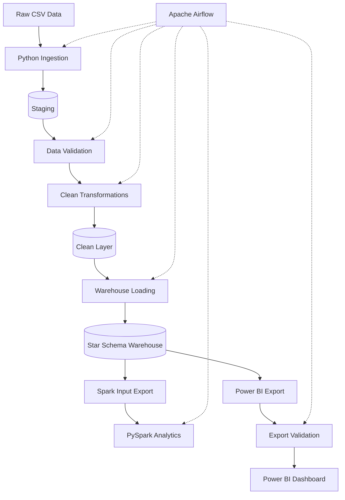

# E-commerce Sales & Customer Analytics

An end-to-end data engineering project that transforms raw e-commerce data into an analytical data warehouse and interactive Power BI dashboards.

The pipeline integrates Python, PostgreSQL, SQL, Apache Airflow, Apache Spark and Power BI to demonstrate data ingestion, incremental processing, data quality validation, dimensional modeling, orchestration and business reporting.

## Project Highlights

- Automated ingestion of raw e-commerce CSV datasets.
- SHA256-based incremental source-file processing.
- PostgreSQL staging and clean data layers.
- Data quality validation at the staging layer.
- Dimensional data warehouse using a star-schema approach.
- SQL-based sales, product, customer, regional and return analytics.
- RFM-style customer segmentation.
- PySpark analytical processing.
- Airflow orchestration with parallel Spark and Power BI branches.
- Power BI CSV export validation.
- Automated unit tests with Pytest.
- GitHub Actions continuous integration.

## Architecture



After the warehouse load, Spark processing and Power BI reporting execute as independent branches.

## Technology Stack

| Area | Technology |
|---|---|
| Programming | Python |
| Database | PostgreSQL |
| Query Language | SQL |
| Data Modeling | Star Schema |
| Orchestration | Apache Airflow |
| Distributed Processing | Apache Spark / PySpark |
| Reporting | Power BI |
| Containerization | Docker, Docker Compose |
| Testing | Pytest |
| CI/CD | GitHub Actions |
| Version Control | Git, GitHub |

## Project Structure

```text
ecommerce-sales-and-customer-analytics/
│
├── .github/
│   └── workflows/
│       └── ci.yml
│
├── airflow/
│   ├── dags/
│   │   └── ecommerce_pipeline.py
│   └── requirements-airflow.txt
│
├── config/
│   └── config.yaml
│
├── dashboard/
│   ├── README.md
│   └── ecommerce_dashboard.pbix
│
├── data/
│   ├── raw/
│   └── processed/ 
│   └── sample/
|
├── docs/
│   ├── architecture.md
│   ├── data_dictionary.md
│   └── runbook.md
│
├── scripts/
│   └── generate_data.py
│
├── spark/
│   └── README.md
│   └── sales_aggregation.py
├── sql/
│   ├── staging/
│   ├── control/
│   ├── transformation/
│   ├── warehouse/
│   └── analytics/
│
├── src/
│   ├── ingestion/
│   ├── validation/
│   ├── transformation/
│   ├── warehouse/
│   ├── analytics/
│   └── spark/
│
├── tests/
│
├── docker-compose.yml
├── Dockerfile.airflow
├── Dockerfile.spark
├── .env.example
├── .gitignore
|── .gitattributes
├── requirements.txt
├── requirements-test.txt
├── pytest.ini
├── LICENSE
└── README.md
```

The tree represents the major project components. Some folders may contain additional SQL files, scripts and modules.

## Pipeline Workflow

The Airflow DAG is named:

`ecommerce_data_pipeline`

### Main ETL Workflow

1. `ingest_staging` — loads source CSV data into staging.
2. `validate_staging` — validates the ingested data.
3. `transform_clean` — standardizes and transforms source data.
4. `build_warehouse` — loads the warehouse dimensions and fact data.

### Spark Branch

5. `export_spark_input` — prepares data for Spark.
6. `spark_analytics` — executes PySpark analytics inside Docker.

### Power BI Branch

7. `export_powerbi_data` — exports analytical datasets to CSV.
8. `validate_powerbi_exports` — validates exported data before reporting.

## Power BI Dashboard

The report is organized into three pages.

### 1. Executive Overview
- Gross sales and net sales KPIs.
- Retained profit and Return Rate.
- Delivered orders.
- Monthly sales trends.
- Category and regional performance.
- Top products.

### 2. Product & Returns
- Product performance.
- Return rate.
- Return reasons.
- Product-level return analysis.
- Category and year filtering.

### 3. Customer Analytics
- Customer segmentation.
- Sales by customer segment.
- High-value customers.
- Customer and regional performance.

The Power BI Desktop report is saved separately at:

`dashboard/ecommerce_dashboard.pbix`

## Setup

### Prerequisites

- Git
- Python
- Docker Desktop
- Power BI Desktop for dashboard development

### Clone the repository

```powershell
git clone https://github.com/aa98-45556443355666/ecommerce-sales-and-customer-analytics.git
cd ecommerce-sales-and-customer-analytics
```

### Configure environment variables

```powershell
Copy-Item .env.example .env
```

Fill the required database and Airflow configuration in `.env`.

Never commit real passwords, database URLs or other secrets.

### Install Python dependencies

```powershell
python -m pip install -r requirements.txt
```

For testing dependencies:

```powershell
python -m pip install -r requirements-test.txt
```

### Start the pipeline

```powershell
docker compose --profile airflow up -d --build
```

Initialize Airflow metadata database only on first-time setup:

```powershell
docker compose --profile airflow run --rm airflow-init
```

Verify the Airflow database:

```powershell
docker compose --profile airflow exec -T airflow-scheduler airflow db check
```

Open:

`http://localhost:8080`

Trigger the `ecommerce_data_pipeline` DAG.

Detailed setup and execution instructions are available in [docs/runbook.md](docs/runbook.md).

## Power BI Exports

Generated reporting CSVs are stored in:

`data/processed/powerbi_output/`

Run export manually:

```powershell
python src/analytics/export_powerbi_data.py
```

Validate the exported files:

```powershell
python src/analytics/validate_powerbi_exports.py
```

## Testing

Check Python syntax:

```powershell
python -m compileall -q scripts src spark airflow/dags
```

Run the unit tests:

```powershell
python -m pytest -q
```

The GitHub Actions workflow runs syntax checks and unit tests on pushes and pull requests.

## Documentation

- [System Architecture](docs/architecture.md)
- [Data Dictionary](docs/data_dictionary.md)
- [Project Runbook](docs/runbook.md)
- [Dashboard Documentation](dashboard/README.md)

## Data and Secrets Policy

- Raw CSV datasets are kept outside version control.
- Processed data exports are generated locally.
- `.env` contains local secrets and must not be committed.
- `.env.example` contains only placeholder configuration.
- Docker volumes preserve database and Airflow metadata between normal container shutdowns.

## License

See [LICENSE](LICENSE).
