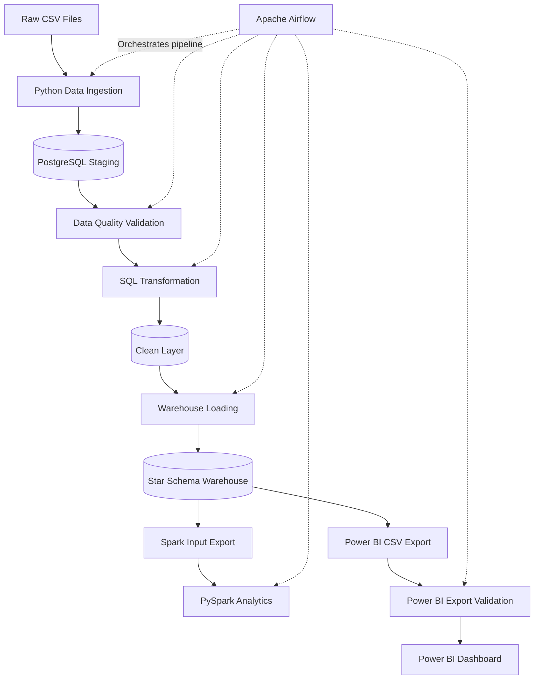
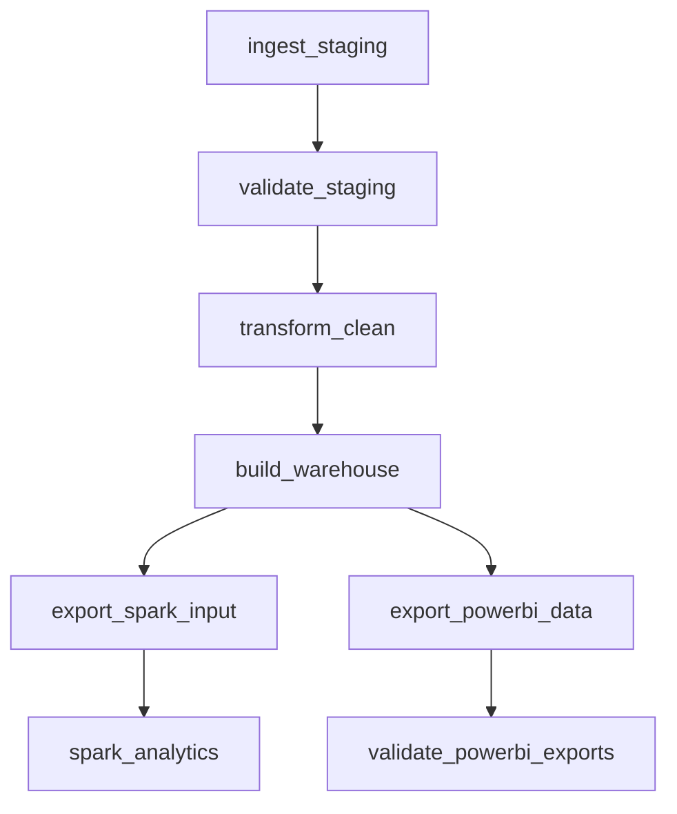

# System Architecture

## 1. Overview

The Ecommerce Sales and Customer Analytics project is an end-to-end data engineering pipeline designed to transform raw e-commerce data into structured analytical datasets.

The pipeline uses Python, PostgreSQL, SQL, Apache Airflow, Apache Spark and Power BI.

## 2. High-Level Architecture

## 3. Airflow DAG Architecture

The pipeline is orchestrated by the `ecommerce_data_pipeline` DAG.

After the warehouse load, Spark analytics and Power BI reporting run as two independent branches.

## 4. Data Pipeline Layers

### Raw Layer
- Contains source CSV files.
- Files are generated using the project's data generation script.
- Raw files remain local and are excluded from Git.

### Staging Layer
- Loads source data into PostgreSQL.
- Performs source-file validation.
- Uses SHA256-based file tracking for incremental ingestion.
- Tracks file state through the ETL control table.

### Clean Layer
- Performs data cleaning and standardization.
- Prepares consistent customer, product, order and return datasets.
- Provides the cleaned data used by downstream warehouse models.

### Data Warehouse Layer
- Implements a dimensional model.
- Contains customer, product, date and region dimensions.
- Contains the sales fact table.
- Supports business reporting and analytical queries.

### Analytics Layer
- Contains SQL analytical views.
- Includes sales, product, customer, regional and return analysis.
- Includes customer segmentation based on RFM-style scores.

### Reporting Layer
- Exports warehouse tables and analytical views into CSV files.
- Validates exported files before Power BI consumption.
- Provides interactive reporting through Power BI.

## 5. Technology Stack

| Component | Technology |
|---|---|
| Programming | Python |
| Data Processing | Pandas, SQL |
| Database | PostgreSQL |
| Data Modeling | Star Schema |
| Orchestration | Apache Airflow |
| Distributed Analytics | Apache Spark / PySpark |
| Reporting | Power BI |
| Containerization | Docker, Docker Compose |
| Testing | Pytest |
| CI | GitHub Actions |
| Version Control | Git, GitHub |

## 6. Database Architecture

Two PostgreSQL services are used:

- Application database: stores staging, clean, warehouse and analytics data.
- Airflow metadata database: stores DAG runs, task states and scheduler metadata.

These databases serve different purposes and should remain separate.

## 7. Incremental Processing

The ingestion process uses source-file hashes to identify changed input files.

Unchanged source files can be skipped. Changed files are reprocessed, and source-file state is maintained transactionally.

The exact incremental behavior of downstream transformations and warehouse loading is implemented in their respective scripts.

## 8. Reliability and Validation

The project includes:
- Source-file validation.
- Staging data quality checks.
- Transactional ingestion.
- Warehouse loading and validation.
- Power BI CSV structure and key validation.
- Automated Python tests.
- GitHub Actions CI.
